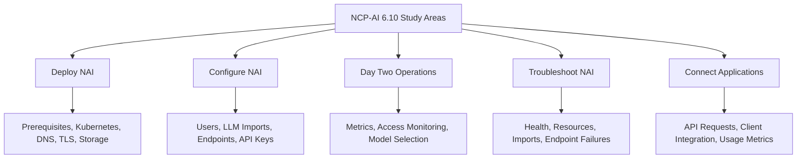
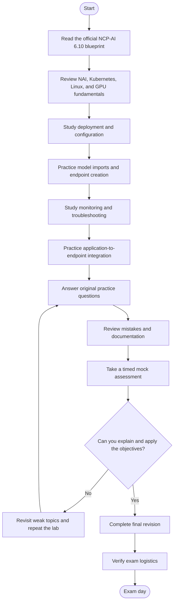
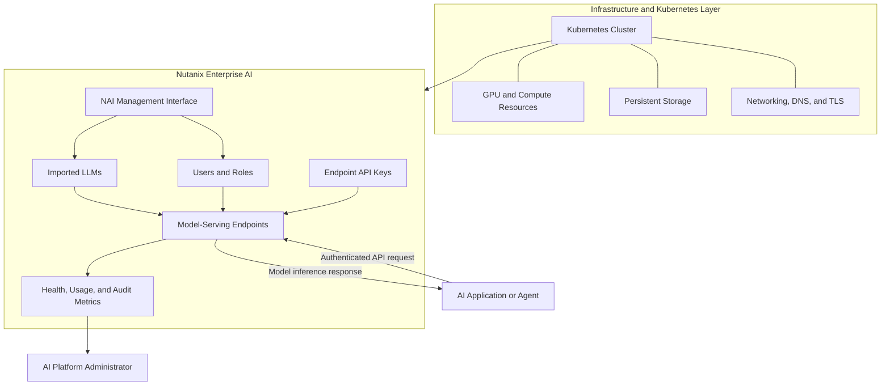
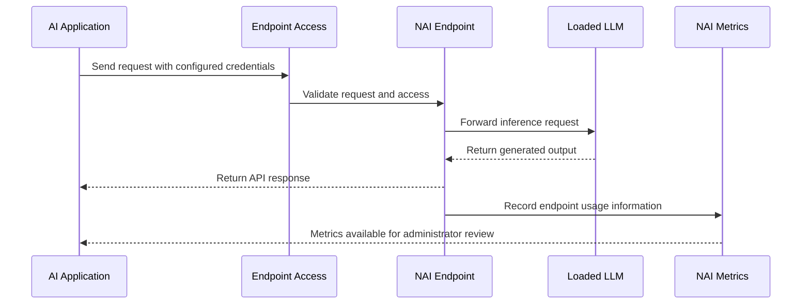
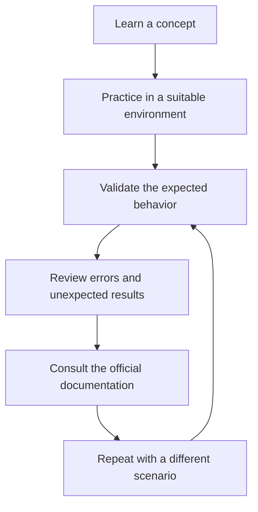
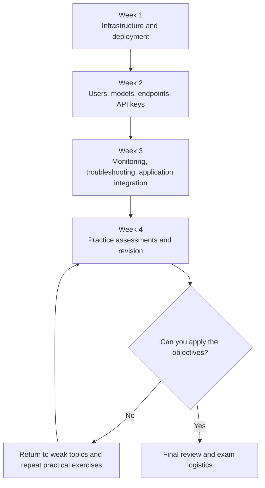

# Nutanix Certified Professional – Artificial Intelligence (NCP-AI 6.10) Study Guide

A practical, exam-focused study guide for the **Nutanix Certified Professional – Artificial Intelligence (NCP-AI) 6.10** certification. This repository helps candidates organize their preparation around Nutanix Enterprise AI (NAI), including deployment, configuration, large language model (LLM) management, endpoint operations, performance monitoring, troubleshooting, and application integration.

The goal is to connect exam objectives with realistic operational scenarios. Rather than relying on memorized definitions, candidates should practice explaining configuration choices, diagnosing failures, and understanding how Kubernetes, GPU resources, storage, networking, and AI model serving work together.

This guide includes an objective checklist, Mermaid diagrams, a suggested roadmap, hands-on project ideas, and original practice questions. You can also explore [CertsGate](https://certsgate.com/exams/nutanix/ncp-ai) for supplementary certification preparation material.

> **Version note:** This repository is aligned with the published NCP-AI 6.10 exam blueprint, which identifies Nutanix Enterprise AI (NAI) 2.3 as the tested software version. Check the official Nutanix certification page for the latest blueprint before scheduling your exam.

## Table of Contents

- [About the Certification](#about-the-certification)
- [Who Should Prepare?](#who-should-prepare)
- [Official Exam Details](#official-exam-details)
- [Exam Objectives](#exam-objectives)
- [Conceptual Skills Map](#conceptual-skills-map)
- [Preparation Flowchart](#preparation-flowchart)
- [Nutanix Enterprise AI Architecture](#nutanix-enterprise-ai-architecture)
- [Application-to-Endpoint Workflow](#application-to-endpoint-workflow)
- [Study and Revision Cycle](#study-and-revision-cycle)
- [Step-by-Step Preparation Guide](#step-by-step-preparation-guide)
- [Suggested Study Roadmap](#suggested-study-roadmap)
- [Hands-On Projects](#hands-on-projects)
- [Original Practice Questions](#original-practice-questions)
- [Troubleshooting Practice](#troubleshooting-practice)
- [Common Preparation Mistakes](#common-preparation-mistakes)
- [Career Relevance](#career-relevance)
- [Frequently Asked Questions](#frequently-asked-questions)
- [Official and Additional Resources](#official-and-additional-resources)
- [About CertsGate](#about-certsgate)

## About the Certification

The **Nutanix Certified Professional – Artificial Intelligence (NCP-AI)** certification validates practical knowledge of deploying, configuring, operating, optimizing, and troubleshooting Nutanix Enterprise AI. It also covers connecting generative AI applications and agents to NAI endpoints.

The NCP-AI 6.10 blueprint focuses on five areas:

1. Deploying a Nutanix Enterprise AI environment.
2. Configuring users, models, endpoints, and API keys.
3. Performing day-two operations and performance optimization.
4. Troubleshooting NAI environments.
5. Connecting applications to NAI and monitoring endpoint usage.

These topics bring infrastructure and AI operations together. A model-serving problem might involve more than the model itself: it could result from insufficient GPU resources, incorrect storage configuration, a failed model download, invalid credentials, or application connectivity.

**Official certification page:** [Nutanix Certified Professional – Artificial Intelligence](https://www.nutanix.com/support-services/training-certification/certifications/certification-details-nutanix-certified-professional-artificial-intelligence)

## Who Should Prepare?

The official blueprint describes candidates with experience in virtual infrastructure, cloud-native technologies, and the Linux command-line interface.

Relevant background includes:

- Virtual machines, hypervisors, and virtual networking.
- Kubernetes installation, management, and troubleshooting.
- Nutanix Cloud Infrastructure (NCI).
- Infrastructure as a Service (IaaS).
- GPU resources and AI workloads.
- Nutanix Unified Storage.
- Deploying and administering enterprise AI environments.

The blueprint describes approximately three years of virtual infrastructure experience and one year of cloud-native and Linux CLI experience as the intended candidate background. It also expects knowledge comparable to the Certified Kubernetes Administrator (CKA) level.

These are descriptions of the target audience, not a claim that every candidate must submit proof of a specific number of years before taking the exam.

The credential may be relevant to cloud engineers, AI platform administrators, developers, support engineers, solution architects, data engineers, and professionals responsible for enterprise AI deployment.

## Official Exam Details

The following information comes from the published NCP-AI 6.10 exam blueprint.

| Exam detail | Published information |
|---|---|
| Certification | Nutanix Certified Professional – Artificial Intelligence |
| Exam version | NCP-AI 6.10 |
| Tested NAI version | 2.3 |
| Question count | 75 |
| Question types | Multiple-choice and multiple-response |
| Time limit | 120 minutes |
| Passing score | 3000 on a scaled score range of 1000–6000 |
| Published price | US$200 per attempt |
| Languages | English and Japanese |
| Delivery | Remote proctoring or in-person at selected test centers |
| Related course | Nutanix Enterprise AI Administration (NAIA) |

**Important:** The passing score is scaled. Do not interpret 3000 as a percentage or assume that it directly represents a particular number of correct answers. Confirm the latest exam policies, fee, delivery options, and version details on the official certification page.

Official reference: [NCP-AI Exam Blueprint Guide (PDF)](https://www.nutanix.com/content/dam/nutanix/en/resources/datasheets/ds-ebg-ncp-ai.pdf)

## Exam Objectives

The official blueprint organizes NCP-AI 6.10 into five sections. The summaries below are study-oriented descriptions of the published objectives.

### 1. Deploy a Nutanix Enterprise AI Environment

Understand the requirements and components needed to deploy NAI successfully.

Study topics include:

- Validating installation prerequisites and limitations.
- Understanding core NAI architecture.
- Comparing installation approaches for Nutanix Kubernetes Platform (NKP) and non-NKP environments.
- Recognizing compatibility between NAI and prerequisite components.
- Understanding air-gapped or dark-site installation considerations.
- Configuring storage classes.
- Setting up a fully qualified domain name (FQDN).
- Configuring DNS and secure certificates.
- Validating access to the NAI user interface.

**Practice goal:** Explain the prerequisites for a deployment, identify dependencies, and work through the checks needed to validate a successful installation.

### 2. Configure a Nutanix Enterprise AI Environment

Learn how to make a deployed environment usable by administrators, application teams, and model consumers.

Study topics include:

- Onboarding users and understanding user roles.
- Limiting privileges appropriately.
- Importing LLMs from supported repositories and sources.
- Understanding model requirements and import credentials.
- Creating and configuring model-serving endpoints.
- Matching model requirements with available GPU, CPU, and memory resources.
- Creating, assigning, activating, and deactivating API keys.
- Delivering endpoint information to application consumers.

**Practice goal:** Trace the process from importing a model to creating a usable endpoint with appropriate access controls.

### 3. Perform Day Two Operations

Day-two operations concern the work performed after installation and initial configuration.

Study topics include:

- Preparing applications to connect to NAI endpoints.
- Interpreting endpoint and infrastructure performance metrics.
- Monitoring access activity and identifying unusual patterns.
- Evaluating model suitability for output quality and operational needs.
- Understanding endpoint usage and resource utilization.
- Using available monitoring and audit information to guide operational decisions.

**Practice goal:** Given a performance or model-quality issue, identify which evidence to review before changing the configuration.

### 4. Troubleshoot a Nutanix Enterprise AI Environment

Practice identifying the layer responsible for an operational failure.

Study topics include:

- Investigating performance and resource utilization problems.
- Reviewing node and cluster health information.
- Diagnosing cluster health-check failures.
- Identifying Kubernetes and NAI resource issues.
- Troubleshooting model-import failures.
- Investigating invalid repository credentials or connectivity.
- Diagnosing endpoint creation and scheduling failures.
- Checking available CPU, memory, GPU, and other resource constraints.

**Practice goal:** Form a troubleshooting hypothesis, collect relevant evidence, isolate the likely cause, apply an appropriate correction, and validate the result.

### 5. Connect Applications to a Nutanix Enterprise AI Environment

Understand how client applications consume models exposed through NAI endpoints.

Study topics include:

- Distinguishing models from endpoints.
- Selecting an appropriate endpoint for an application.
- Using OpenAI-compatible clients where supported.
- Making simple API requests using Python or `curl`.
- Troubleshooting authentication and application connectivity.
- Interpreting endpoint request and latency metrics.
- Correlating application behavior with NAI endpoint usage.

**Practice goal:** Explain the path from an application request to a model-serving endpoint and identify where authentication, networking, resource, or configuration problems might occur.

For the full list of objectives and associated product documentation, use the [official exam blueprint](https://www.nutanix.com/content/dam/nutanix/en/resources/datasheets/ds-ebg-ncp-ai.pdf).

## Conceptual Skills Map

The published blueprint lists five objective sections but does not provide percentage weightings for them. The following diagram is therefore a **conceptual study map**, not an official exam-weight chart.

Use the map to organize revision and identify gaps. Do not infer that every section has equal weight or that a particular number of questions will come from each one.

## Preparation Flowchart

A structured preparation process helps connect reading, practical exercises, and assessment. Return to the relevant objective whenever a practice result exposes an important gap.

A practice assessment is most useful when it reveals what to study next. Repeating questions without understanding the underlying product behavior is a weak substitute for hands-on work.

## Nutanix Enterprise AI Architecture

The diagram below is an illustrative learning model for understanding the main relationships in an NAI environment. It is not a complete or mandatory deployment design.

### Key components to understand

| Component | Purpose in the study model |
|---|---|
| Kubernetes | Provides the cloud-native environment in which supported NAI components run |
| GPU and compute resources | Supply the resources needed to run supported models and serve inference requests |
| Storage | Supports the persistent data required by the deployment |
| DNS and certificates | Help provide name resolution and secure access to the configured service |
| NAI management interface | Supports administrative tasks such as user, model, and endpoint management |
| LLM | The model used to generate responses or perform supported inference tasks |
| Endpoint | An interface through which an application accesses a deployed model |
| API key | A credential used for authorized endpoint access according to the configured model |
| Monitoring and audit information | Helps administrators understand health, usage, performance, and access activity |

Exact components, deployment choices, and requirements depend on the NAI version and supported environment. Consult Nutanix documentation for implementation details.

## Application-to-Endpoint Workflow

Application integration is a central part of NCP-AI preparation. This sequence diagram illustrates a simplified interaction between a client application and a model endpoint.

This is a conceptual workflow. Actual request handling, authentication, telemetry, and response behavior depend on the client, endpoint configuration, and NAI implementation.

When practicing, verify the endpoint URI, supported request format, required parameters, and API key handling. Also learn how to inspect latency and request metrics when a client reports slow or failed responses.

## Study and Revision Cycle

Preparation should repeat until the underlying concepts make sense in practical scenarios.

For example, if an endpoint cannot be created, do not immediately assume the model is faulty. Check the available resources, model requirements, prerequisites, endpoint configuration, and relevant health information. Use the evidence to narrow down the cause.

## Step-by-Step Preparation Guide

### Step 1: Read the official blueprint

Start with the [NCP-AI 6.10 Exam Blueprint Guide](https://www.nutanix.com/content/dam/nutanix/en/resources/datasheets/ds-ebg-ncp-ai.pdf).

Create a checklist for all five objective sections. Mark each objective as:

- Not studied.
- Learning.
- Practiced.
- Ready to explain and apply independently.

The detailed objectives include related Nutanix documentation. Use those references to guide further reading.

### Step 2: Refresh infrastructure and Kubernetes fundamentals

Before concentrating on NAI, review the foundations it depends on.

Focus on:

- Kubernetes clusters, nodes, workloads, and storage concepts.
- Linux command-line navigation and troubleshooting.
- Virtual machines, hypervisors, and virtual networking.
- CPU, memory, and GPU resource allocation.
- Persistent storage and storage classes.
- DNS, FQDNs, certificates, and secure connections.

The goal is to understand how infrastructure problems can affect AI services.

### Step 3: Study deployment requirements

Review NAI architecture, installation prerequisites, supported deployment options, and version compatibility.

Pay attention to differences between supported NKP and non-NKP installation approaches, along with any air-gapped deployment requirements described in the official documentation.

Create a deployment checklist that includes prerequisites, resource requirements, DNS, certificates, storage, and post-installation validation.

### Step 4: Practice user, model, and endpoint administration

Understand the lifecycle of an LLM in NAI:

1. Confirm the model's requirements and supported import method.
2. Check repository access and required credentials.
3. Import the model.
4. Verify that the model is available.
5. Create an endpoint using suitable resources.
6. Configure endpoint access.
7. Test the endpoint and review its details.

Practice explaining what can prevent each stage from succeeding.

### Step 5: Learn monitoring and day-two operations

Review available health, performance, endpoint, and audit information. Understand what each metric tells you and what it cannot tell you by itself.

For example, high latency could have several causes. Investigate workload demand, model configuration, available resources, and endpoint behavior before selecting a remediation.

### Step 6: Practice troubleshooting systematically

Use a consistent sequence:

1. Reproduce or clearly define the symptom.
2. Identify the component or layer most likely involved.
3. Collect relevant logs, health details, and metrics.
4. Check configuration, connectivity, credentials, and resource availability.
5. Apply a targeted correction.
6. Retest and verify that the issue is resolved.

Avoid making several unrelated changes at once. Doing so makes it harder to determine which change affected the result.

### Step 7: Connect a client application

Use the official NAI documentation to learn how to access an endpoint through a supported client.

The blueprint specifically includes simple requests through Python or `curl` using OpenAI-compatible NAI API endpoints. Practice identifying the endpoint URI, required request fields, authentication requirements, and response behavior.

Never commit real API keys, access tokens, or other secrets to a public GitHub repository.

### Step 8: Assess readiness

Use practice questions and a timed mock assessment after studying the objectives. Review every incorrect or uncertain answer and connect it to a specific topic in the blueprint.

You should be able to explain a workflow, identify likely failure points, and justify a troubleshooting step—not merely recognize terminology.

## Suggested Study Roadmap

The following four-week plan is an **independent recommendation**, not an official Nutanix schedule. Adapt it to your background, lab access, and available study time.

| Week | Focus | Suggested output |
|---|---|---|
| 1 | Kubernetes, Linux, infrastructure prerequisites, NAI deployment | A deployment checklist and architecture notes |
| 2 | User roles, LLM imports, endpoints, API keys | A model-to-endpoint workflow checklist |
| 3 | Performance metrics, health checks, troubleshooting, API integration | Troubleshooting notes and a working client example, where available |
| 4 | Practice questions, timed mock tests, weak-area revision | An objective checklist with documented gaps and next actions |

If you already have strong Kubernetes and infrastructure experience, spend more time on NAI-specific model imports, endpoint behavior, monitoring, and integration.

## Hands-On Projects

The following exercises are independent learning projects. They are not official exam tasks. Use an authorized lab or suitable test environment and follow the current NAI deployment requirements.

### Project 1: NAI deployment planning

**Goal:** Understand the requirements for a reliable deployment.

Create a deployment plan that documents:

- Supported environment and installation approach.
- Required software versions and compatibility checks.
- Kubernetes and infrastructure prerequisites.
- CPU, memory, GPU, and storage considerations.
- DNS, FQDN, and certificate requirements.
- Installation validation and health checks.

**Deliverable:** A deployment checklist with each requirement linked to the relevant official documentation.

### Project 2: Model import and endpoint lifecycle

**Goal:** Trace the lifecycle from an available model to an application-ready endpoint.

Document the steps for:

- Selecting a model and checking its requirements.
- Validating access to the required model repository.
- Importing the model.
- Selecting appropriate endpoint resources.
- Creating and testing the endpoint.
- Configuring access credentials.
- Reviewing endpoint details and available metrics.

**Deliverable:** A model-to-endpoint runbook that explains each stage and the checks needed to validate it.

### Project 3: API client integration

**Goal:** Understand how an application consumes an NAI endpoint.

Where a suitable endpoint and authorized credentials are available:

- Record the endpoint URI and supported request format.
- Send a simple request using Python or `curl`.
- Verify authentication and response handling.
- Test expected and invalid request cases.
- Review endpoint metrics after making requests.

**Deliverable:** A minimal client example with placeholders for the endpoint URI and credentials. Never include real secrets in the repository.

### Project 4: Endpoint performance investigation

**Goal:** Practice investigating slow or inconsistent inference behavior.

Create a troubleshooting worksheet that records:

- The reported symptom.
- Relevant endpoint and infrastructure metrics.
- Model and endpoint configuration.
- Available CPU, memory, and GPU resources.
- The evidence collected.
- The proposed change and why it is appropriate.
- The result after retesting.

**Deliverable:** A short incident report that distinguishes observed evidence from assumptions.

### Project 5: Model import failure investigation

**Goal:** Learn to reason about a failed model import.

Consider potential issues such as repository credentials, network connectivity, model availability, required permissions, and supported configuration.

For each potential cause, write down what evidence would help confirm or reject it. Use official NAI documentation to identify the appropriate checks for the environment.

**Deliverable:** A troubleshooting decision tree that starts with symptoms and leads to evidence-based next steps.

## Original Practice Questions

These questions are original educational examples designed to reinforce the published objectives. They are **not official Nutanix exam questions**, and they do not claim to reproduce or predict live exam content.

<strong>Question 1: Deployment prerequisites</strong>

Before deploying Nutanix Enterprise AI, what is the most appropriate first step?

A. Create an endpoint before checking the environment.  
B. Validate the installation prerequisites, limitations, and supported deployment requirements.  
C. Disable all certificates.  
D. Import a model without checking compatibility.

**Answer: B**

A deployment should begin with a review of prerequisites, supported configurations, and dependencies. This reduces avoidable installation and compatibility problems.

<strong>Question 2: Model import credentials</strong>

A model import from an external repository fails. Which investigation is reasonable?

A. Check the relevant repository credentials, connectivity, and model-access requirements.  
B. Assume the GPU is defective without collecting evidence.  
C. Delete unrelated endpoints immediately.  
D. Ignore the error and continue.

**Answer: A**

Repository access and connectivity are plausible causes of import failures. The appropriate diagnosis depends on the error details and the configured import method.

<strong>Question 3: Endpoint resource requirements</strong>

An endpoint cannot be scheduled because the environment does not have sufficient available GPU resources. What should you investigate?

A. The repository README's title.  
B. Model requirements and the cluster's available allocatable resources.  
C. The application's display theme.  
D. An unrelated API key.

**Answer: B**

Endpoint creation depends on the requirements of the selected model and the resources available in the environment. Verify the specific scheduling error and the documented requirements before making changes.

<strong>Question 4: API access</strong>

An application receives an authentication error when calling an NAI endpoint. What is a sensible first investigation?

A. Check the endpoint URI, API key configuration, and credential status.  
B. Increase GPU memory immediately.  
C. Reinstall every Kubernetes component.  
D. Change the model's name.

**Answer: A**

Confirm that the application is using the correct endpoint and valid credentials. If authentication is correct, continue investigating the request format and other relevant configuration.

<strong>Question 5: Performance monitoring</strong>

Users report slow inference responses. Which approach is most useful?

A. Change several configuration settings without checking metrics.  
B. Review endpoint performance, request activity, and available infrastructure resources before selecting a remediation.  
C. Assume every model has identical resource requirements.  
D. Ignore the reported latency.

**Answer: B**

Performance metrics and resource information help narrow down the likely cause. A targeted change should follow evidence-based diagnosis.

<strong>Question 6: Cluster health checks</strong>

An NAI health check reports a failure. What should the administrator do?

A. Determine which component or layer is associated with the failure and review the relevant evidence.  
B. Delete all model files immediately.  
C. Assume the application code is always responsible.  
D. Ignore the health status if the UI opens.

**Answer: A**

Health-check failures can involve different components. Identify the failing layer and follow the relevant official troubleshooting guidance before applying a correction.

<strong>Question 7: Endpoint usage</strong>

An administrator needs to understand how an application is using a model endpoint. Which information is relevant?

A. Endpoint request counts and latency information, where available.  
B. The color of the client's interface.  
C. The repository's Git history alone.  
D. The model's display name only.

**Answer: A**

The published objectives include checking endpoint metrics corresponding to application usage. Use available metrics to correlate activity with the relevant application and endpoint.

<strong>Question 8: Exam readiness</strong>

A candidate can define NAI terms but struggles to diagnose endpoint creation failures. What is the best next step?

A. Memorize the terms again without practicing.  
B. Practice the endpoint workflow, investigate likely failure causes, and review the relevant official documentation.  
C. Skip troubleshooting topics.  
D. Assume terminology knowledge guarantees readiness.

**Answer: B**

The exam covers operational and troubleshooting abilities. Practical scenarios help turn definitions into usable knowledge.

### How to use practice questions

- Attempt each question before revealing the answer.
- Explain why the correct option fits the scenario.
- Identify why the alternatives are less appropriate.
- Link the question to the corresponding exam objective.
- Reproduce the relevant workflow in a suitable environment.
- Record recurring gaps and revisit them before taking another mock test.

Independent resources such as [CertsGate](https://certsgate.com/exams/nutanix/ncp-ai) can supplement this process. Check that any third-party material is relevant to NCP-AI 6.10 and consistent with the current official blueprint.

## Troubleshooting Practice

NCP-AI preparation benefits from a consistent method for investigating failures.

| Symptom | Areas to investigate | Evidence to collect |
|---|---|---|
| Installation does not complete | Prerequisites, compatibility, deployment method, storage, networking | Installation messages and environment configuration |
| NAI URL is inaccessible | DNS, FQDN, certificate, network path | Name-resolution results and relevant certificate or connection errors |
| Model import fails | Repository access, credentials, connectivity, model requirements | Import logs and the relevant error message |
| Endpoint creation fails | Model requirements, CPU, memory, GPU availability, prerequisites | Endpoint details, scheduling information, resource status |
| API call is rejected | Endpoint URI, API key, request format, endpoint status | HTTP response, request configuration, access settings |
| Inference is slow | Request load, model configuration, resource utilization, endpoint metrics | Latency information and relevant node or endpoint metrics |
| Health check fails | NAI components, Kubernetes resources, cluster health | Health-check details and associated logs or events |

This table is an independent troubleshooting aid, not a complete list of possible causes. The correct steps depend on the specific NAI version, deployment type, and reported error.

## Common Preparation Mistakes

### Studying only AI terminology

The exam focuses on operating Nutanix Enterprise AI, not only defining LLMs or generative AI concepts. Study deployment, configuration, monitoring, and troubleshooting.

### Ignoring Kubernetes fundamentals

Cloud-native knowledge supports several NAI objectives. Review clusters, storage, resource allocation, and common operational troubleshooting concepts.

### Memorizing commands without understanding their purpose

Learn what each step accomplishes and what a successful result looks like. You should be able to explain why a check matters and what to investigate if it fails.

### Treating model import and endpoint creation as the same task

Importing makes a model available in the environment; creating an endpoint exposes a selected model for supported inference access. Learn the requirements and troubleshooting considerations for each stage.

### Overlooking credentials and access controls

Repository credentials and endpoint API keys serve different purposes. Understand where each is used, how it is managed, and how invalid or inactive credentials can affect operations.

### Ignoring metrics

Performance troubleshooting requires evidence. Practice interpreting available endpoint, node, and cluster information instead of guessing at the cause.

### Using outdated guides

The published blueprint identifies a specific exam and product version. Recheck the official page and current documentation before using older notes or third-party practice material.

### Treating mock-test scores as proof of readiness

A score is only one signal. Review incorrect and uncertain answers, map them to the blueprint, and test the underlying concepts through practical work.

## Career Relevance

NCP-AI preparation can help professionals develop practical knowledge for work involving enterprise AI platforms, cloud-native infrastructure, model serving, and AI application integration.

Related work may include:

- AI platform administration.
- Cloud and infrastructure engineering.
- Kubernetes and platform operations.
- Generative AI application integration.
- AI workload monitoring and troubleshooting.
- Technical support for enterprise AI environments.

The certification is one way to demonstrate knowledge of a defined product and skill set. Practical experience, clear troubleshooting methods, and the ability to explain operational decisions remain important in real environments.

## Frequently Asked Questions

### What is NCP-AI 6.10?

It is the Nutanix Certified Professional – Artificial Intelligence exam version focused on deploying, configuring, operating, optimizing, and troubleshooting Nutanix Enterprise AI, including integration with generative AI applications and agents.

### How many questions are on the exam?

The published blueprint lists 75 multiple-choice and multiple-response questions.

### How long is the exam?

The published time limit is 120 minutes.

### What is the passing score?

The published passing score is 3000 on a scaled score range of 1000–6000. It should not be interpreted as a percentage.

### What does the exam cost?

The published blueprint lists US$200 per attempt. Confirm the current fee and any applicable registration terms on the official Nutanix page.

### Is there an official domain-weight percentage chart?

The published NCP-AI 6.10 blueprint lists five objective sections but does not provide percentage weights for them. This repository therefore does not assign numerical weights or present invented exam distributions.

### Which product version is covered?

The published blueprint identifies Nutanix Enterprise AI version 2.3 for NCP-AI 6.10. Verify the current blueprint before preparing for a different exam version.

### Is the Nutanix Enterprise AI Administration course required?

The blueprint recommends the Nutanix Enterprise AI Administration (NAIA) course. It also states that attendance at a course is not required to take the exam. Check current certification policies for any changes.

### Are the practice questions in this repository official?

No. They are original educational examples created to reinforce the published subject areas. They are not official, leaked, or guaranteed exam questions.

### Can CertsGate replace Nutanix documentation?

No. CertsGate can be a supplementary preparation resource. Use the official Nutanix blueprint and product documentation as the primary references for exam objectives and product behavior.

## Official and Additional Resources

### Official Nutanix certification resources

1. **[NCP-AI Certification Details](https://www.nutanix.com/support-services/training-certification/certifications/certification-details-nutanix-certified-professional-artificial-intelligence)**  
   Official exam overview, question count, duration, price, languages, and links to the blueprint.

2. **[NCP-AI 6.10 Exam Blueprint Guide (PDF)](https://www.nutanix.com/content/dam/nutanix/en/resources/datasheets/ds-ebg-ncp-ai.pdf)**  
   Detailed objectives, intended audience, exam policies, and relevant technical references.

3. **[Nutanix Enterprise AI Administration (NAIA)](https://www.nutanix.com/support-services/training-certification/training/course-details-nutanix-enterprise-artificial-intelligence-administration)**  
   Official training covering deployment, user administration, model imports, endpoints, API keys, monitoring, and troubleshooting.

4. **[Nutanix Certifications](https://www.nutanix.com/support-services/training-certification/certifications)**  
   Browse the broader Nutanix certification portfolio.

5. **[Nutanix Support and Documentation](https://portal.nutanix.com/)**  
   Product documentation and support resources. Some documentation may require an account or authorized access.

### Supplementary learning

- **[Nutanix Community](https://next.nutanix.com/)** — Discussions and product learning from the Nutanix community.
- **[Kubernetes Documentation](https://kubernetes.io/docs/)** — Core Kubernetes concepts that support cloud-native preparation.
- **[CertsGate NCP-AI Preparation Page](https://certsgate.com/exams/nutanix/ncp-ai)** — Independent study and practice material, where available.

Prioritize the latest official blueprint and the documentation it references. Use supplementary resources to reinforce concepts and identify gaps, then verify product-specific details against Nutanix documentation.

## About CertsGate

[CertsGate](https://certsgate.com/) is an independent IT certification preparation resource. Depending on the certification, its materials may include study guides, practice questions, mock-test-style exercises, and related learning resources.

For NCP-AI 6.10, supplementary practice is most useful when it helps learners understand NAI deployment, model imports, endpoint configuration, monitoring, and troubleshooting. Pair third-party material with official Nutanix resources and practical exercises.

This repository does not claim that CertsGate is an official Nutanix training provider or certification partner.

